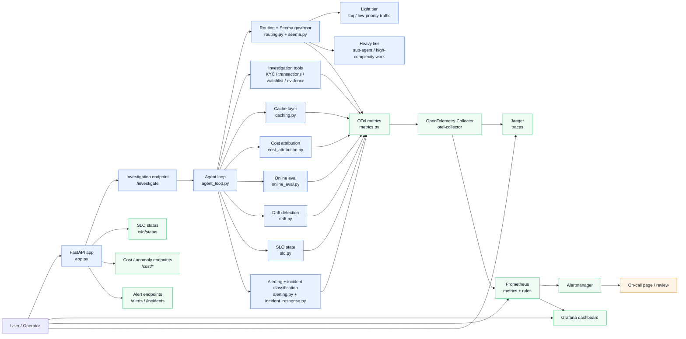

# Niyantran architecture

This architecture shows the end-to-end control loop of the assignment:

- external traffic enters the FastAPI app
- the agent loop routes work through the Seema governor
- cost, cache, eval, drift, SLO, and incident signals are emitted as OTel metrics
- Prometheus evaluates sustained alert rules
- Grafana and Alertmanager provide operational visibility and paging

The design deliberately couples a real service path with a fully observable operations plane, so the same request can be traced, measured, and reasoned about end-to-end.
